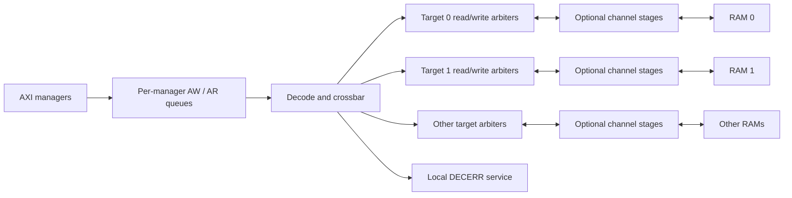
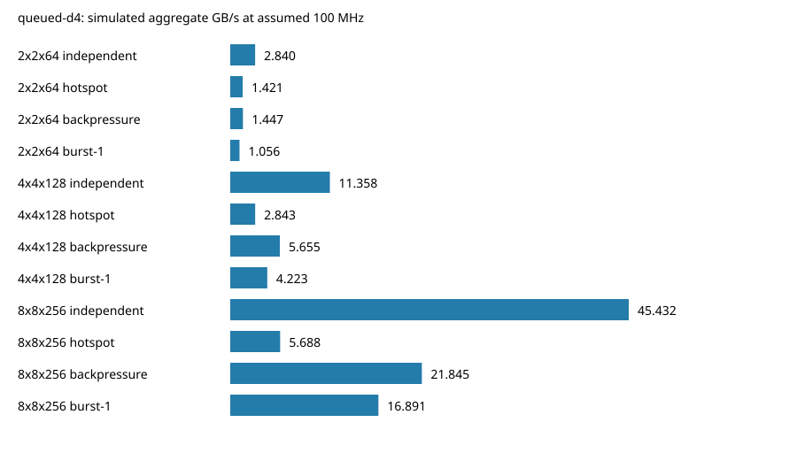
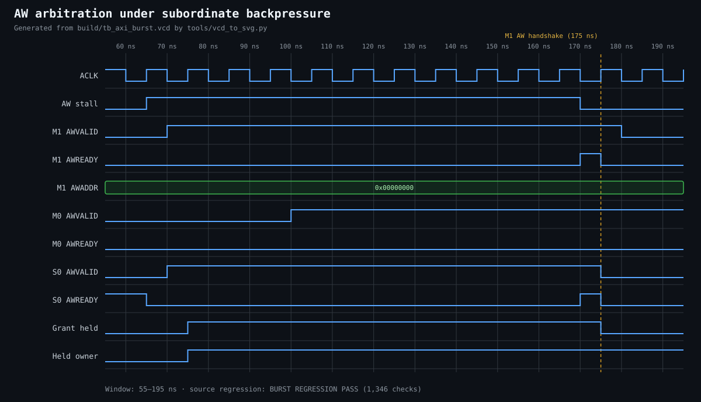

# Concurrent AXI4 Burst Interconnect

[](https://github.com/csepka/complete-axi-bus/actions/workflows/ci.yml) [](LICENSE)

A parameterized SystemVerilog memory interconnect with **per-target arbitration,
bounded outstanding request queues, strict per-manager ordering, and optional
registered target channels**. It incrementally extends the preserved
single-outstanding baseline rather than replacing the project.

At 8x8/256 bits, the measured 16-beat independent-target workload falls from **4,608
to 577 cycles (7.99x)**. At an **assumed 100 MHz**, that is **45.432 GB/s aggregate
(363.458 Gb/s)** across reads and writes. These are simulated cycle results;
reference technology mapping and extracted timing are reported separately below.
The initial 8x8 physical run fails hold/capacitance checks, so these rates remain
simulation results at an assumed clock.

## Architecture and bounded policy



`MAX_OUTSTANDING=4` accepts four requests **per manager, per direction**, including
the executing head. Only one head per manager/direction issues at once. Independent
managers can use independent targets concurrently; a blocked head prevents that
manager's later requests from bypassing it. All responses remain ordered per
manager, including different IDs. IDs may overlap across managers because target
ownership determines return routing. W data is never interleaved.

`TARGET_PIPELINE=1` inserts two-entry stages on all five channels at real targets.
It cuts combinational paths across that boundary but adds cycles/storage. It is
disabled by default; no unmeasured Fmax benefit is claimed.

## Measured comparison

16-beat INCR, 32 requests per manager per direction, independent targets, ready
sinks, full strobes, seed 7; 100 MHz **assumed**, startup/drain included.

| Configuration | Baseline cycles | Queued depth-4 cycles | Aggregate GB/s | Aggregate Gb/s |
|---|---:|---:|---:|---:|
| 2x2 / 64-bit | 1,152 | 577 | 2.840 | 22.716 |
| 4x4 / 128-bit | 2,304 | 577 | 11.358 | 90.864 |
| 8x8 / 256-bit | 4,608 | 577 | 45.432 | 363.458 |



Hotspot traffic remains limited by one target. The optional pipeline increases the
8x8 main workload to 641 cycles. See [full comparison](docs/architecture_comparison.md),
[100 Gb/s analysis](docs/performance_100g.md), and [benchmark methodology](benchmarks/README.md)
for single-direction rates, unfavorable cases, latency, occupancy, stalls and raw CSV.

## Verified features and explicit limits

| Feature | Implemented scope |
|---|---|
| Five AXI channels / IDs / backpressure | End-to-end routing and stall-stability assertions |
| Concurrent independent targets | Up to min(NM,NS) useful reads and writes concurrently |
| Bounded outstanding requests | Configurable per-manager AW/AR queues; depth 4 default |
| Ordering | Strict per-manager/per-direction completion order; no different-ID bypass |
| FIXED / INCR / WRAP | FIXED <=16; INCR <=256 subject to 4 KiB; WRAP 2/4/8/16 |
| Byte strobes | Per-byte updates on full-width aligned transactions |
| Optional pipelining | Two-entry stages for AW/W/B/AR/R at each real target |
| Decode / validation errors | DECERR on misses; RAM SLVERR on invalid mapped requests |
| Width / count validation | Benchmarks at 2x2/64, 4x4/128, 8x8/256 plus asymmetric cases |
| Narrow / unaligned transfers | Forwarding verified with independent external RAM models; demo RAM rejects them |
| Exclusives, atomics, CACHE/QOS/REGION/USER, AXI5 | Not implemented |
| Full AXI compliance, formal closure, silicon proof | Not claimed |

The command-port `axi_top` is intentionally serial; direct-AXI benches measure the
fabric. Default target windows are 64 KiB, with 4 KiB RAM implemented per window.
Accesses outside RAM but inside its window return SLVERR; unmapped windows return
DECERR. Reset cancels work but does not clear memory or roll back completed writes.

## Run it

Dependencies: Verilator 5.x, Yosys, Python 3, GNU Make and a C++20 compiler.
Locally verified with Verilator 5.044 and Yosys 0.57. CI pins an EDA-suite release.

```sh
make ci                          # lint, default regressions, corrected RAM synthesis
make extended                    # depth/pipeline/netlist/seed/parameter checks
make benchmark                   # default measured performance matrix
python3 tools/validate_upgrade.py # complete before/after evidence reproduction
make waveform                    # VCD-derived arbitration waveform
```

Default results: **418 integration + 1,618 burst + 525 outstanding checks**, plus
**5,455 FIFO payload checks** and separate carry/page-boundary regressions. Extended
runs include depths 1/3/5, pipeline traffic, independent scoreboards, overlapping
IDs, reset with pending work, mixed errors, asymmetric ports, 40-bit addresses,
multiple seeds, and synthesized queue/slice substitutions. Counts are comparisons,
not code/functional coverage percentages. See [verification](docs/verification.md).

## Synthesis evidence

Actual coarse synthesis covers the RAM, mechanically flattened request queue, and
register slice. The original baseline command stopped before process lowering;
that flow and its documentation are corrected. The default 32-bit RAM has 275
coarse operator cells, 162 explicit FF bits and 32,768 memory bits. These are
**not full-fabric or ASIC area figures**.

The pinned OpenROAD flow now executes full-fabric synthesis, Nangate45 mapping,
placement, routing, parasitic extraction and STA. At 100 MHz, the 2x2/64-bit pipelined
fabric has 31,245.4 um² standard-cell area, +7.27049 ns setup slack and +0.0278701 ns
hold slack. The original 2x2 baseline uses 2,891.15 um² under identical constraints.
Both have zero router errors but four KLayout antenna markers; the reference
platform lacks its configured LVS deck. **Physical signoff remains incomplete.**
See [reference flow and exact evidence](synthesis/physical/README.md).

[Independent AXI tests](verification/README.md) now cover RTL and full-fabric
four-state generic, mapped and routed netlists, using external BFMs and byte-level
oracles. Inductive proofs check the two-entry FIFO at WIDTH=8 and request-queue order/accounting
at depths 1/3/4/5; deliberate corruption tests produce counterexamples. These
results extend assurance without claiming full AXI4 compliance or formal closure.

## Learn and review

- [Engineering mastery](ENGINEERING_MASTERY.md): every major module, timing walkthroughs,
  design tradeoffs and **74 implementation-grounded interview questions/answers**.
- [Architecture](docs/architecture.md): acceptance policy, ownership, decode and reset.
- [Engineering audit](docs/engineering_audit.md): findings, fixes and remaining gaps.
- [Project progress](PROJECT_PROGRESS.md): preserved baseline, milestones and exact resume steps.
- [Source map](src/README.md) and [tests](tb/README.md).



The trace distinguishes manager-queue acceptance from later target acceptance while
a target grant is held under backpressure.

## License and protocol reference

MIT — [LICENSE](LICENSE). Protocol reference:
[Arm AMBA AXI and ACE specification](https://developer.arm.com/documentation/ihi0022/latest).
