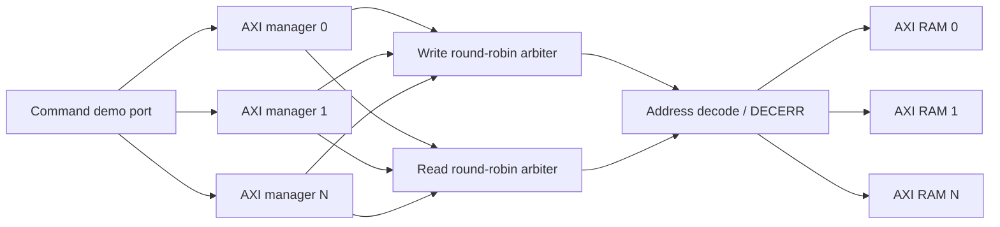

# Parameterized AXI4 Burst Interconnect

[](https://github.com/csepka/complete-axi-bus/actions/workflows/ci.yml) [](LICENSE) [](src)

A synthesizable SystemVerilog AXI4 interconnect demonstrating subsystem RTL design, AMBA integration, protocol validation, and hardware build automation. The design connects a configurable number of managers and memory-mapped subordinates through independent read and write datapaths.

> **Scope:** This is an intentionally bounded AXI4 implementation, not AXI5 and not a claim of full AMBA conformance. The supported and unsupported features are explicit below.

**Proof points:** five AXI channels · FIXED, INCR, and WRAP bursts · legal bursts up to 256 beats · 1,764 self-checking regression checks plus SVA monitoring

## Architecture



The read and write arbiters operate independently. Each allows one globally active transaction, locks its manager/subordinate route for the complete burst, and advances a round-robin pointer after address acceptance. This provides concurrency between one read and one write while keeping ordering behavior easy to reason about and verify.

See [the architecture document](docs/architecture.md) for microarchitecture, reset behavior, address decode, and design tradeoffs.

## Regression Waveform


*Generated from the passing burst regression: manager 1 retains the AW grant while subordinate 0 applies backpressure, even after manager 0 requests service. The address transfers when the stall is released.* Regenerate it with `make waveform`; the raw VCD remains ignored.

## Supported Feature Matrix

| Feature | Status | Notes |
|---|---:|---|
| Five AXI channels | ✅ | AW, W, B, AR, R |
| `VALID/READY` backpressure | ✅ | Payload stability checked with SVA |
| Transaction IDs | ✅ | Routed end to end; one active read and write globally |
| FIXED bursts | ✅ | Up to 16 beats |
| INCR bursts | ✅ | Up to 256 beats; 4-KiB rule checked |
| WRAP bursts | ✅ | Legal lengths 2, 4, 8, and 16 |
| Write strobes | ✅ | Per-byte lane updates |
| Read/write concurrency | ✅ | Independent arbitration state machines |
| Multiple outstanding transactions | ❌ | One read plus one write may be active globally |
| Out-of-order responses | ❌ | Not needed under the single-outstanding policy |
| Narrow transfers | ❌ | Requests smaller than the bus width are rejected |
| Unaligned transfers | ❌ | Rejected with `SLVERR` |
| Exclusive accesses / atomics | ❌ | LOCK/ATOP not implemented |
| CACHE/QOS/REGION/USER sidebands | ❌ | Deliberately outside this project’s interface |
| AXI5 poison, trace, or MPAM | ❌ | This project targets an AXI4 core subset |

## Quick Start

### Dependencies

- Verilator 5.x
- Yosys 0.40 or newer
- GNU Make
- A C++20 compiler

On macOS with Homebrew:

```bash
brew install verilator yosys make
```

Run the complete local CI flow:

```bash
make ci
```

Expected regression summaries:

```text
TOP REGRESSION PASS: 418 checks
BURST REGRESSION PASS: 1346 checks
```

Useful individual targets:

```bash
make lint        # warning-clean integrated RTL lint
make test        # both self-checking simulations
make synth       # Yosys elaboration and coarse synthesis of axi_ram
make waves       # burst regression with VCD tracing
make waveform    # regenerate the documented SVG from the traced regression
make clean       # remove generated build products
```

## Address Map

The default interconnect assigns one contiguous 64-KiB window per subordinate (`S_ADDR_WIDTH=16`):

| Subordinate | Address range |
|---:|---|
| 0 | `0x0000_0000`–`0x0000_FFFF` |
| 1 | `0x0001_0000`–`0x0001_FFFF` |
| 2 | `0x0002_0000`–`0x0002_FFFF` |

Only `MEM_BYTES` bytes are physically implemented in each window (4 KiB by default). Accesses in a valid window but beyond that RAM return `SLVERR`; accesses beyond the configured subordinate windows return `DECERR` from the interconnect.

## Repository Layout

```text
src/
  axi_if.sv                AXI channel interface and modports
  axi_interconnect.sv      independent read/write arbitration and routing
  axi_mgr.sv               single-beat command-to-AXI demonstration manager
  axi_ram.sv               flat-port burst-capable synthesizable RAM target
  axi_sub.sv               interface wrapper around axi_ram
  axi_protocol_checker.sv  reusable handshake/payload SVA
tb/
  tb_top.sv                randomized command-level integration regression
  tb_axi_burst.sv          direct protocol-level burst/concurrency regression
  axi_stall_sub.sv         test-only channel-backpressure shim
docs/
  architecture.md          microarchitecture and design decisions
  signals.md               implemented signal contract
  verification.md          verification strategy and coverage map
  images/axi-aw-backpressure.svg  regression-derived waveform evidence
tools/
  vcd_to_svg.py            dependency-free waveform renderer
synthesis/
  subordinate/config.json  OpenLane-ready RAM-core configuration
.github/workflows/ci.yml    automated lint, simulation, and synthesis
```

## Verification Evidence

`tb_top` checks endpoint routing, manager selection, memory isolation, error propagation, and 250 deterministic randomized command transactions. `tb_axi_burst` directly drives the AXI interfaces to check all supported burst types, IDs, byte strobes, backpressure, simultaneous managers, independent reads/writes, and negative/error cases. Both testbenches use bounded timeouts and self-checking scoreboards.

The protocol checker asserts that AW, W, B, AR, and R payloads remain stable whenever `VALID=1` and `READY=0`, and checks that last-beat indicators are known whenever their channels are valid.

See [verification.md](docs/verification.md) for the requirement-to-test map.

## Design Limitations and Next Steps

The implementation favors clear, reviewable control logic over maximum throughput. The logical next milestone is per-subordinate arbitration with multiple outstanding ID-tracked transactions. Additional production steps would include formal liveness/fairness proofs, CDC/reset-domain integration, ECC, low-power intent, configurable sparse address maps, and a technology-specific SRAM wrapper.

## License

MIT — see [LICENSE](LICENSE).

## Protocol Reference

- [Arm AMBA AXI and ACE Protocol Specification](https://developer.arm.com/documentation/ihi0022/latest)
