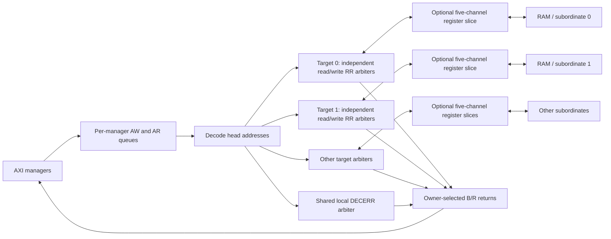

# AXI4 interconnect architecture

## Contract and scope

This is a single-clock AXI4 core subset: AW/W/B and AR/R, IDs, byte strobes,
FIXED/INCR/WRAP, aligned full-width accesses and backpressure. Optional LOCK,
CACHE, QOS, REGION, USER, atomics and AXI5 extensions are absent. PROT is forwarded
but the RAM performs no privilege/security checking. This is not full AXI4
compliance certification.

`axi_top` remains a deliberately serial command-port demonstration. Connect
managers directly to `axi_interconnect` to exercise concurrency.

## Topology

`axi_target_arbiter` retains the baseline arbitration/datapath implementation.
Each instance has one physical endpoint (`NS=1`). A separate instance with
`FORCE_DECERR=1` services decode misses. Read and write state machines are
independent in every instance. The interface crossbar is generated structurally;
there is no runtime indexing of interface arrays.

## Accepted versus executing transactions

`MAX_OUTSTANDING` (default 4) is the **per-manager, per-direction accepted but not
completed** capacity, including the executing head. AW and AR queues are separate.
Each stores address, PROT, ID, length, size and burst. No full data burst is buffered.
For 32-bit addresses and 4-bit IDs a request is 52 bits; payload capacity is
`2 * NM * MAX_OUTSTANDING * 52` bits, plus counters/ownership/control.

Only the head of each manager queue is dispatched. The head remains allocated
until upstream B acceptance or upstream final R acceptance. Thus:

- Up to `NM * MAX_OUTSTANDING` writes and the same number of reads can be accepted.
- Up to `min(NM,NS)` useful target transactions per direction execute concurrently.
- One manager executes at most one read and one write; later requests to another
  target cannot bypass a blocked head.
- Every manager's responses remain in acceptance order, even across different IDs
  and targets. Different managers may complete independently.
- W data follows AW acceptance order. W is stalled until its head address has
  dispatched, and is stopped after AWLEN+1 beats until the response retires.
- A full queue deasserts AxREADY. It does not accept a replacement in the same
  cycle a full queue pops; admission resumes on the next cycle.

This is bounded multiple-outstanding acceptance with conservative execution,
not unrestricted per-manager parallel dispatch or out-of-order completion.

## IDs and ownership

An arbiter records its manager owner on address acceptance. It routes every W/B
or R beat using that owner until completion. External IDs pass unchanged. Equal
IDs from different managers are safe because owner state identifies the return
port; the ID alone is never used to infer a manager. The queue head retains its
address (and therefore target selection) through completion.

Strict head issue enforces same-ID ordering and also serializes different IDs.
No ID extension, remap table or response reorder buffer is required by this
policy. Enabling multiple executing heads per manager would require redesigning
that policy, including W issue order, response selection and stalled-response locks.

## Arbitration and fairness

Every real/error target has independent read and write round-robin pointers.
An idle arbiter scans valid head requests from its pointer. If the address stalls,
a held owner/route prevents a later requester from changing the presented payload.
The pointer advances on address acceptance. W ownership lasts through B acceptance;
R ownership lasts through the final R beat.

Fairness is conditional: a continuously requesting eligible manager is served
within a round of completed competing grants if selected managers send their data,
targets complete, and response sinks eventually accept. No finite cycle bound
exists under indefinitely asserted backpressure. A blocked target does not block
other targets, but a manager's blocked head blocks that manager's later requests.

## Optional target pipeline

`TARGET_PIPELINE=1` inserts `axi_register_slice` between each real target arbiter
and subordinate. AW, W, AR travel forward; B, R travel backward. Each channel uses
an independent two-entry `axi_channel_fifo`. READY depends only on registered
occupancy; output VALID/payload depend on stored state. This cuts combinational
paths across the target boundary in both directions.

An empty channel adds one cycle. Occupancy one permits simultaneous enqueue and
dequeue at one beat per cycle. When full, the first draining cycle cannot also
enqueue: a one-cycle input recovery bubble is intentional. Address and response
stages add transaction latency. No bypass path is used when enabled.

The target arbiter retains ownership until the buffered response reaches the
manager. Independent channel buffering may deliver AW and W at different times;
targets must apply normal AXI handshakes. Reset clears all slice occupancy together
with queues and target ownership. Default is bypass (`0`), because measured
cycles increase and technology-specific Fmax benefit is not yet known.

## Decode and errors

Subordinate s occupies `[BASE_ADDR + s*2^S_ADDR_WIDTH,
BASE_ADDR + (s+1)*2^S_ADDR_WIDTH - 1]`. BASE_ADDR must be window aligned. Widened
arithmetic checks that the complete map fits in ADDR_W. Default windows are 64 KiB.
Addresses retain their absolute value through the fabric. RAM uses the low
`ADDR_OFFSET_W` bits; base alignment makes that the local window offset.

Decode miss: drain AWLEN+1 W beats and return original-ID DECERR, or produce
ARLEN+1 zero-data DECERR beats with the original ID and correctly placed RLAST.
Invalid accesses inside a valid window are checked by RAM and return SLVERR.
The error target is shared, so error bursts contend with each other but do not
occupy real targets.

## RAM behavior

The RAM accepts one write and one read concurrently. FIXED is limited to 16 beats;
INCR to 256 subject to page/extent rules; WRAP lengths are 2, 4, 8 or 16. Bus width
must be a power of two, and transfers must be aligned and full-width. The complete
burst must fit the implemented RAM. INCR cannot cross a 4-KiB page. WSTRB merges
bytes with previous contents. WLAST must match the declared final beat.

Malformed WLAST is not an atomic rollback: earlier writes, and the beat on which
the error is detected, can modify memory. A missing declared data beat cannot be
recovered without cooperation/reset. Behavioral same-edge read/write to the same
word reads old data; a technology SRAM wrapper must preserve or explicitly
redefine that integration contract. Concurrent application traffic to shared
addresses needs synchronization outside this fabric.

Storage writes have no reset. Simulation initializes memory for legacy tests;
hardware power-up contents are unspecified. Benchmarks explicitly preload their
fixture outside the measurement interval.

## Reset and parameters

ARESETn asserts asynchronously; the system must synchronize deassertion. Reset
cancels all accepted work without completing responses and must cover managers,
fabric and subordinates together. RAM contents are not cleared. Payload arrays
are not reset: zero occupancy makes stale values invalid.

| Parameter | Interconnect default | Meaning |
|---|---:|---|
| NM / NS | 2 / 2 | Manager / target count (axi_top defaults to 3 / 3) |
| ADDR_W / DATA_W / ID_W | 32 / 32 / 4 | Address/data/ID widths |
| S_ADDR_WIDTH | 16 | Log2 decode-window bytes |
| BASE_ADDR | 0 | Aligned first window address |
| MAX_OUTSTANDING | 4 | Accepted requests per manager per direction |
| TARGET_PIPELINE | 0 | Enable two-slot stages on all target channels |
| MEM_BYTES (RAM/top) | 4096 | Implemented RAM bytes per target |

See [verification](verification.md) for configurations actually tested. Elaborating
a parameter combination is not itself proof of correct operation.

## Reference implementation boundary

The [physical reference flow](../synthesis/physical/README.md) implements the
complete fabric with external flattened ports and preserves the interface-array
RTL internally until native elaboration. It excludes demonstration managers/RAMs.
Queues and slices become standard-cell storage, including unreset payload flops;
reset valid/count/owner state keeps idle payloads unobservable. Four-state netlist
tests check meaningful payloads and handshake controls. Layout buffering and clock
tree insertion must preserve logical behavior, while STA checks separate timing
constraints. The existing strict issue/ordering policy is unchanged.
